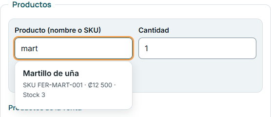
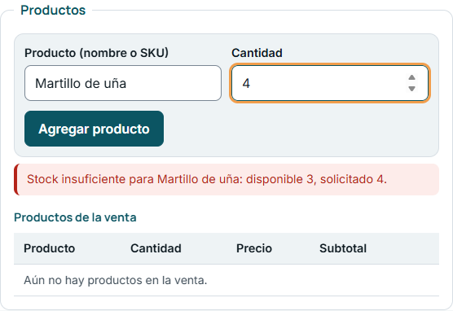
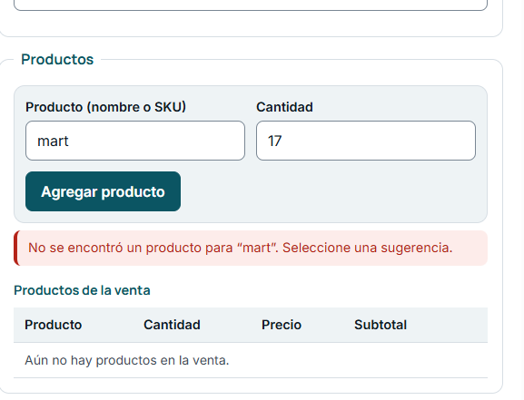
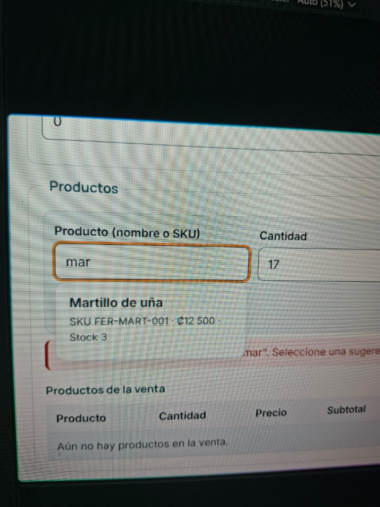

# Registro de cambios y evidencias

**Proyecto:** Ferretería Pescado Volador
**Frontend:** JavaScript puro con Vite
**API:** Laravel
**Fecha de actualización:** 26/11/2026

## Resumen

Se completó la interfaz funcional del nuevo front, se reorganizó el código por módulos y se agregaron las pantallas operativas necesarias para los roles administrador, cajero y bodeguero. También se incorporaron estados de carga, datos vacíos y errores, restricciones por permisos y mejoras específicas para ventas e inventario.

## Cambios realizados

### 1. Arquitectura y navegación

- Se organizó el JavaScript en `nucleo`, `componentes`, `paginas` y `reglas`.
- Se agregaron páginas independientes para ventas, recepción, compras, proveedores, clientes, movimientos y catálogos.
- Se centralizó la sesión, los permisos y las llamadas HTTP en `src/nucleo/comun.js`.
- Se agregó protección por permiso en páginas y secciones.
- Los usuarios sin acceso son redirigidos automáticamente a la primera pantalla permitida.
- Se separó el historial de ventas de la captura o edición de una venta.

### 2. Autenticación y manejo de respuestas

- Se implementó el inicio y cierre de sesión con token.
- Un `401` elimina la sesión y redirige a `login.html?motivo=expirada`.
- Los datos de formularios se conservan al expirar la sesión.
- Los errores `403`, `404`, `422` y los errores de conexión tienen mensajes visibles.
- Los errores `422` se muestran junto al campo correspondiente.

### 3. Productos e inventario

- Se mejoró el listado de productos con búsqueda por nombre, SKU y código de barras.
- Se agregó el detalle de producto en una ventana emergente.
- Se incorporaron formularios de creación y edición con validaciones.
- Se agregó resumen de inventario.
- Se agregó impresión de etiqueta de código de barras.
- Se implementaron estados de carga, lista vacía y error con reintento.

### 4. Ventas

- Se agregó un combobox para seleccionar productos por nombre o SKU.
- Las sugerencias muestran precio y stock disponible.
- Se cancelan búsquedas anteriores al escribir y se espera una pausa breve antes de consultar la API.
- Se permite agregar varias líneas a una venta.
- Los totales se calculan automáticamente por subtotal, impuesto y descuento.
- Se retiraron los campos editables de impuesto y descuento; las ventas nuevas usan cero y al editar se conservan los valores existentes.
- Se impide agregar cantidades mayores al stock disponible.
- Al repetir un producto se suma la cantidad sin duplicar la línea.
- Se agregó edición de la cabecera de la venta y el listado del historial.

### 5. Compras y recepción

- Se agregó el listado de compras con detalle de sus líneas.
- Se agregó búsqueda de una compra pendiente por código de barras.
- Se permite confirmar la recepción de cantidades pendientes.
- Se muestra el estado de disponibilidad de productos en recepción.

### 6. Administración y catálogos

- Se agregaron pantallas de clientes, proveedores y catálogos.
- Los catálogos incluyen categorías, marcas y unidades de medida.
- Las operaciones de alta, edición y eliminación respetan los permisos del rol.
- Se agregó el Kardex de movimientos de inventario.

### 7. Diseño y accesibilidad

- Se creó un sistema visual basado en variables CSS.
- Se agregó modo claro y modo oscuro.
- Se mejoraron formularios, tablas, botones, mensajes y diálogos.
- Se incorporaron atributos `aria-*` en controles y sugerencias.
- Las vistas principales fueron adaptadas para móvil y escritorio.

### 8. Compilación y configuración

- Se registraron todas las páginas HTML en `vite.config.js`.
- La compilación exige una variable `VITE_API_URL` configurada.
- Se agregaron instrucciones de configuración en `.env.example` y `README.md`.
- Se corrigió la configuración de CI y la compilación del frontend.

## Evidencias existentes

Las capturas organizadas en `evidencias/nuevo-front/` cubren los cambios principales:

| Evidencia | Captura |
|---|---|
| Inicio de sesión | `01-login.png` |
| Productos y estados | `02-productos-listado.png` a `14-productos-movil-390.png` |
| Sesión vencida | `15-sesion-expirada-vuelve-login.png` |
| Ventas | `20-ventas-nueva-venta.png` a `23-ventas-editar-cabecera.png` |
| Compras, movimientos y catálogos | `30-compras-listado.png` a `36-catalogos-categorias-marcas-unidades.png` |
| Restricciones del cajero | `40-cajero-productos-sin-alta.png` a `42-cajero-clientes-solo-lectura.png` |
| Flujo del bodeguero | `50-bodeguero-recepcion-pendientes.png` a `54-bodeguero-sin-acceso-redirige-productos.png` |
| Diseño móvil | `60-ventas-movil-390.png` y `61-login-movil-390.png` |

### Capturas nuevas: combobox y límite de stock en ventas

Estas capturas muestran el combobox con el producto sugerido y el rechazo de una cantidad superior al inventario disponible:

Para estas dos capturas se usaron respuestas de demostración interceptadas localmente, ya que el navegador no pudo conectarse a la API por CORS. No se modificó el backend ni se registraron ventas.

Captura adicional aportada: búsqueda sin coincidencias en el combobox.

Captura aportada del combobox mostrando el producto sugerido, su SKU, precio y stock.

## Validación pendiente

- Completar la prueba de creación de ventas con varios productos contra el backend desplegado.
- Completar la prueba de recepción de compras en cada escenario.
- Confirmar la edición y eliminación de productos con permisos reales.
- Confirmar la edición de ventas y las restricciones por usuario.
- Agregar pruebas automatizadas de los módulos críticos.
